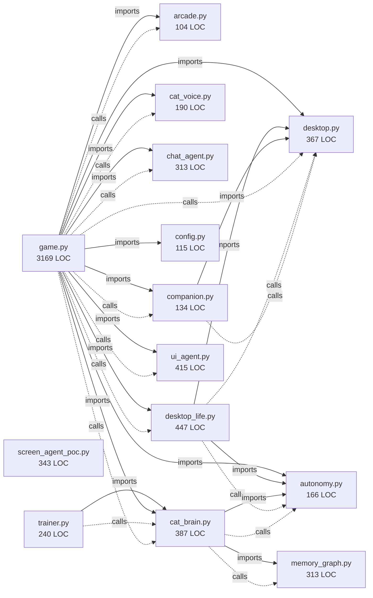

# LittleCat - project graph

Generated by `python tools/graphify.py` (do not edit by hand).

Nodes: {'class': 15, 'data': 10, 'method': 215, 'function': 59, 'module': 14} - edges: 715

## Modules

## Brain / learning flow (calls)

```mermaid
graph TD
  n0["autonomy.falling"] --> n1["autonomy.rising"]
  n2["autonomy.score_actions"] --> n3["autonomy.circadian_activity"]
  n2["autonomy.score_actions"] --> n0["autonomy.falling"]
  n2["autonomy.score_actions"] --> n1["autonomy.rising"]
  n4["autonomy.score_desktop"] --> n3["autonomy.circadian_activity"]
  n4["autonomy.score_desktop"] --> n0["autonomy.falling"]
  n4["autonomy.score_desktop"] --> n1["autonomy.rising"]
  n5["CatBrain.__init__"] --> n6["CatBrain._generate_personality"]
  n7["CatBrain._get_state"] --> n8["CatBrain._bin"]
  n9["CatBrain.decide_action"] --> n10["autonomy.choose"]
  n9["CatBrain.decide_action"] --> n2["autonomy.score_actions"]
  n9["CatBrain.decide_action"] --> n7["CatBrain._get_state"]
  n9["CatBrain.decide_action"] --> n11["MemoryGraph.recent_actions"]
  n9["CatBrain.decide_action"] --> n12["memory_graph.state_tags"]
  n13["CatBrain.get_status"] --> n14["CatBrain._get_mood"]
  n13["CatBrain.get_status"] --> n15["MemoryGraph.summary"]
  n16["CatBrain.learn_from_interaction"] --> n17["CatBrain._apply_trick_progress"]
  n16["CatBrain.learn_from_interaction"] --> n7["CatBrain._get_state"]
  n16["CatBrain.learn_from_interaction"] --> n18["CatBrain._update_q"]
  n16["CatBrain.learn_from_interaction"] --> n19["MemoryGraph.record"]
  n20["CatBrain.load_brain"] --> n21["MemoryGraph.from_dict"]
  n20["CatBrain.load_brain"] --> n22["MemoryGraph.from_legacy"]
  n23["CatBrain.save_brain"] --> n24["MemoryGraph.to_dict"]
  n25["LittleCatGame.auto_perform_action"] --> n16["CatBrain.learn_from_interaction"]
  n26["LittleCatGame.perform_action"] --> n16["CatBrain.learn_from_interaction"]
  n27["LittleCatGame.play_with_toy"] --> n16["CatBrain.learn_from_interaction"]
  n28["LittleCatGame.resolve_mini_game"] --> n16["CatBrain.learn_from_interaction"]
  n29["LittleCatGame.run"] --> n13["CatBrain.get_status"]
  n29["LittleCatGame.run"] --> n30["LittleCatGame.save_all_profiles"]
  n29["LittleCatGame.run"] --> n31["LittleCatGame.update"]
  n30["LittleCatGame.save_all_profiles"] --> n23["CatBrain.save_brain"]
  n31["LittleCatGame.update"] --> n9["CatBrain.decide_action"]
  n31["LittleCatGame.update"] --> n32["CatBrain.update_state"]
  n31["LittleCatGame.update"] --> n25["LittleCatGame.auto_perform_action"]
  n31["LittleCatGame.update"] --> n28["LittleCatGame.resolve_mini_game"]
  n31["LittleCatGame.update"] --> n33["LittleCatGame.update_achievements"]
  n31["LittleCatGame.update"] --> n34["LittleCatGame.update_arcade"]
  n31["LittleCatGame.update"] --> n35["LittleCatGame.update_chat_response"]
  n31["LittleCatGame.update"] --> n36["LittleCatGame.update_companion"]
  n31["LittleCatGame.update"] --> n37["LittleCatGame.update_desktop_life"]
  n31["LittleCatGame.update"] --> n38["LittleCatGame.update_reminders"]
  n31["LittleCatGame.update"] --> n39["LittleCatGame.update_voice"]
  n36["LittleCatGame.update_companion"] --> n31["LittleCatGame.update"]
  n37["LittleCatGame.update_desktop_life"] --> n31["LittleCatGame.update"]
  n40["MemoryGraph._reinforce"] --> n41["MemoryGraph._edge_id"]
  n42["MemoryGraph.expectation"] --> n41["MemoryGraph._edge_id"]
  n22["MemoryGraph.from_legacy"] --> n19["MemoryGraph.record"]
  n43["MemoryGraph.habit_after"] --> n44["MemoryGraph.neighbors"]
  n19["MemoryGraph.record"] --> n45["MemoryGraph._consolidate"]
  n19["MemoryGraph.record"] --> n40["MemoryGraph._reinforce"]
  n19["MemoryGraph.record"] --> n46["MemoryGraph._touch_node"]
  n19["MemoryGraph.record"] --> n47["MemoryGraph.decay"]
  n19["MemoryGraph.record"] --> n48["memory_graph.extract_stimuli"]
  n19["MemoryGraph.record"] --> n12["memory_graph.state_tags"]
  n15["MemoryGraph.summary"] --> n49["MemoryGraph.favorites"]
  n12["memory_graph.state_tags"] --> n50["memory_graph._bin_label"]
```

## Largest functions (refactor candidates)

| function | file | LOC |
|---|---|---|
| `game.LittleCatGame.handle_input` | src/game.py:1663 | 189 |
| `game.LittleCatGame.update` | src/game.py:2890 | 186 |
| `game.LittleCatGame.__init__` | src/game.py:1516 | 146 |
| `game.GameDisplay.make_cat_sprite` | src/game.py:386 | 138 |
| `ui_agent.SeniorUIAgent.__init__` | src/ui_agent.py:20 | 115 |
| `chat_agent.ChatAgent._process_request` | src/chat_agent.py:158 | 96 |
| `game.GameDisplay.draw_chat_ui` | src/game.py:1188 | 91 |
| `game.GameDisplay.make_item_sprite` | src/game.py:1360 | 90 |
