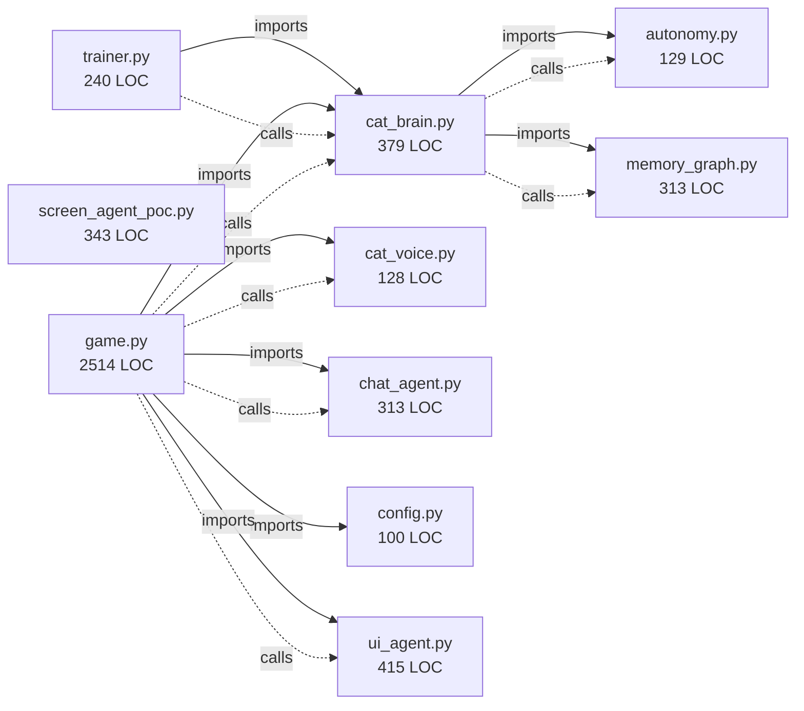

# LittleCat - project graph

Generated by `python tools/graphify.py` (do not edit by hand).

Nodes: {'class': 11, 'data': 8, 'function': 35, 'method': 149, 'module': 10} - edges: 459

## Modules

## Brain / learning flow (calls)

```mermaid
graph TD
  n0["autonomy.falling"] --> n1["autonomy.rising"]
  n2["autonomy.score_actions"] --> n3["autonomy.circadian_activity"]
  n2["autonomy.score_actions"] --> n0["autonomy.falling"]
  n2["autonomy.score_actions"] --> n1["autonomy.rising"]
  n4["CatBrain.__init__"] --> n5["CatBrain._generate_personality"]
  n6["CatBrain._get_state"] --> n7["CatBrain._bin"]
  n8["CatBrain.decide_action"] --> n9["autonomy.choose"]
  n8["CatBrain.decide_action"] --> n2["autonomy.score_actions"]
  n8["CatBrain.decide_action"] --> n6["CatBrain._get_state"]
  n8["CatBrain.decide_action"] --> n10["MemoryGraph.recent_actions"]
  n8["CatBrain.decide_action"] --> n11["memory_graph.state_tags"]
  n12["CatBrain.get_status"] --> n13["CatBrain._get_mood"]
  n12["CatBrain.get_status"] --> n14["MemoryGraph.summary"]
  n15["CatBrain.learn_from_interaction"] --> n16["CatBrain._apply_trick_progress"]
  n15["CatBrain.learn_from_interaction"] --> n6["CatBrain._get_state"]
  n15["CatBrain.learn_from_interaction"] --> n17["CatBrain._update_q"]
  n15["CatBrain.learn_from_interaction"] --> n18["MemoryGraph.record"]
  n19["CatBrain.load_brain"] --> n20["MemoryGraph.from_dict"]
  n19["CatBrain.load_brain"] --> n21["MemoryGraph.from_legacy"]
  n22["CatBrain.save_brain"] --> n23["MemoryGraph.to_dict"]
  n24["LittleCatGame.auto_perform_action"] --> n15["CatBrain.learn_from_interaction"]
  n25["LittleCatGame.perform_action"] --> n15["CatBrain.learn_from_interaction"]
  n26["LittleCatGame.play_with_toy"] --> n15["CatBrain.learn_from_interaction"]
  n27["LittleCatGame.resolve_mini_game"] --> n15["CatBrain.learn_from_interaction"]
  n28["LittleCatGame.run"] --> n12["CatBrain.get_status"]
  n28["LittleCatGame.run"] --> n29["LittleCatGame.save_all_profiles"]
  n28["LittleCatGame.run"] --> n30["LittleCatGame.update"]
  n29["LittleCatGame.save_all_profiles"] --> n22["CatBrain.save_brain"]
  n30["LittleCatGame.update"] --> n8["CatBrain.decide_action"]
  n30["LittleCatGame.update"] --> n31["CatBrain.update_state"]
  n30["LittleCatGame.update"] --> n24["LittleCatGame.auto_perform_action"]
  n30["LittleCatGame.update"] --> n27["LittleCatGame.resolve_mini_game"]
  n30["LittleCatGame.update"] --> n32["LittleCatGame.update_achievements"]
  n30["LittleCatGame.update"] --> n33["LittleCatGame.update_chat_response"]
  n30["LittleCatGame.update"] --> n34["LittleCatGame.update_reminders"]
  n30["LittleCatGame.update"] --> n35["LittleCatGame.update_voice"]
  n36["MemoryGraph._reinforce"] --> n37["MemoryGraph._edge_id"]
  n38["MemoryGraph.expectation"] --> n37["MemoryGraph._edge_id"]
  n21["MemoryGraph.from_legacy"] --> n18["MemoryGraph.record"]
  n39["MemoryGraph.habit_after"] --> n40["MemoryGraph.neighbors"]
  n18["MemoryGraph.record"] --> n41["MemoryGraph._consolidate"]
  n18["MemoryGraph.record"] --> n36["MemoryGraph._reinforce"]
  n18["MemoryGraph.record"] --> n42["MemoryGraph._touch_node"]
  n18["MemoryGraph.record"] --> n43["MemoryGraph.decay"]
  n18["MemoryGraph.record"] --> n44["memory_graph.extract_stimuli"]
  n18["MemoryGraph.record"] --> n11["memory_graph.state_tags"]
  n14["MemoryGraph.summary"] --> n45["MemoryGraph.favorites"]
  n11["memory_graph.state_tags"] --> n46["memory_graph._bin_label"]
```

## Largest functions (refactor candidates)

| function | file | LOC |
|---|---|---|
| `game.LittleCatGame.handle_input` | src/game.py:1420 | 181 |
| `game.LittleCatGame.update` | src/game.py:2270 | 156 |
| `game.GameDisplay.make_cat_sprite` | src/game.py:341 | 134 |
| `game.LittleCatGame.__init__` | src/game.py:1298 | 121 |
| `ui_agent.SeniorUIAgent.__init__` | src/ui_agent.py:20 | 115 |
| `chat_agent.ChatAgent._process_request` | src/chat_agent.py:158 | 96 |
| `game.GameDisplay.draw_chat_ui` | src/game.py:1082 | 91 |
| `game.LittleCatGame.play_with_toy` | src/game.py:2070 | 77 |
